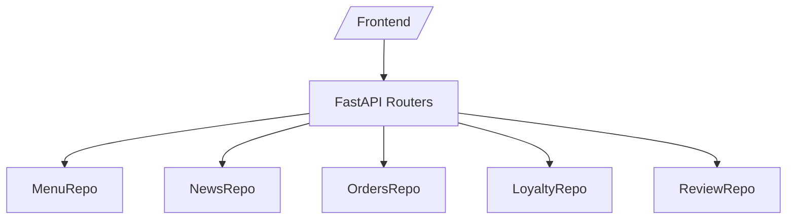

# Архитектура (OpenSpec)

## Стек
- Backend: Python + FastAPI (OpenAPI, валидация)
- Data: in‑memory dict/list; `data/seed.json` при старте
- Tests: pytest, fastapi.testclient, pytest-benchmark
- Frontend: статический UI, смонтированный под `/ui/`

## Слои
- Routers (FastAPI) → services/helpers → in‑memory repositories

## Соглашения
- Версионирование: админские под `/api/v1/*`, публичные алиасы под `/api/*`
- Формат ошибок: `HTTPException(status_code, detail="message")`
- Именование моделей: `MenuItem`, `Order`, `NewsItem`, `Review`

## Диаграмма компонентов

## Формат ошибок
- 404: "Позиция меню не найдена", "Заказ не найден", "Новость не найдена"
- 400: "Invalid menuId", "Недопустимый menuId"
