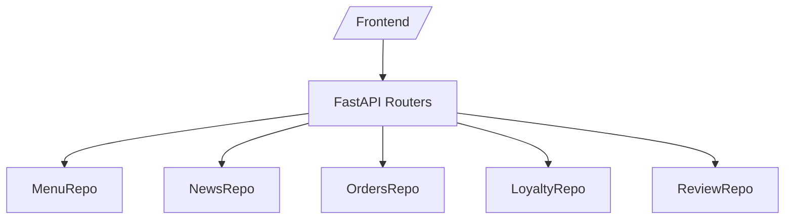

## Архитектура (Spec Kit)

### Стек и уровни
- Backend: FastAPI; уровни — routers → helpers → in-memory repos
- Data: in-memory; seed через `data/seed.json`
- Tests: pytest, fastapi.testclient, pytest-benchmark
- Frontend: статический UI (при переносе — React/Vite)

### Соглашения
- Админские эндпоинты: `/api/v1/*`; публичные алиасы: `/api/*`
- Формат ошибок: `HTTPException(..., detail="...")`
- Именование моделей: MenuItem, Order, NewsItem, Review, StoreHours, Loyalty

### Диаграмма

Подробности см. backend/plan.md и frontend/plan.md.
