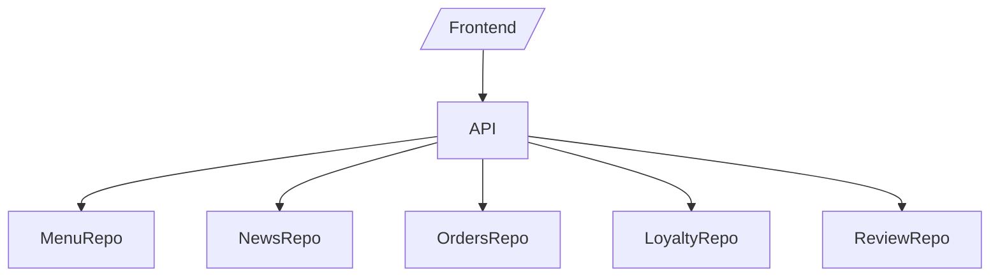

# Архитектура

Стек и обоснование
- FastAPI для типизированных, валидированных REST API
- In-memory хранение для простоты практики
- pytest + fastapi.testclient для тестов
- pytest-benchmark для бенчмарков на критичных путях

Слои
- API-роутеры (FastAPI) → сервисы/хелперы → in-memory репозитории

Соглашения
- RESTful эндпоинты под /api/v1
- Ошибки через HTTPException с понятными detail
- Версионирование через /v1 при необходимости
- PEP 8, type hints; комментарии только для неочевидного

Фронтенд
- Минимальный vanilla JS (ES-модули) и CSS переменные, без тяжёлых фреймворков
- Обоснование: в учебной среде это быстрее собрать; при переносе в React — использовать Vite и прокси на бэкенд

Компоненты

Запуск
- uvicorn app.main:app --reload
